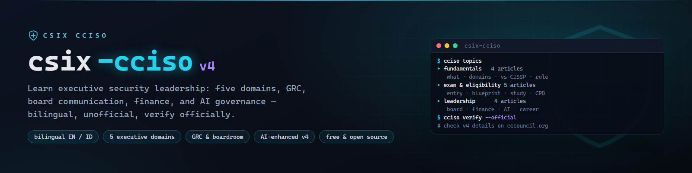

# csix-cciso



**Basis belajar CCISO v4 gratis dua bahasa (EN/ID) — kepemimpinan keamanan eksekutif, lima domain, syarat, blueprint ujian, framework tata kelola, komunikasi dewan, keuangan, tata kelola AI, dan karier CISO.**

[](https://github.com/siedysoes/csix-cciso/actions/workflows/ci.yml)
[](LICENSE)
[](https://siedysoes.github.io/csix-cciso/)
[](https://www.eccouncil.org/train-certify/certified-chief-information-security-officer-cciso/)

`csix-cciso` adalah basis pengetahuan terstruktur dan ramah pemula tentang
jalur **Certified Chief Information Security Officer (CCISO)** dari EC-Council.
Program resminya saat ini memakai merek **CCISO v4 — AI-Enhanced** (dicek
26 Nov 2026). Situs ini menjelaskan lima domain eksekutif, jalur syarat,
ujian dan blueprint, framework tata kelola, komunikasi dewan, risiko dan
keuangan, tata kelola AI, serta karier kepemimpinan yang realistis.

> ⚠️ **Sumber belajar independen.** EC-Council, CCISO, CISSP, CISM, CISA dan
> nama kredensial lain adalah merek dagang pemiliknya. Proyek ini **tidak
> resmi** dan **tidak berafiliasi atau didukung oleh EC-Council**. Tidak ada
> materi kursus resmi, bocoran soal, atau konten berhak cipta di sini. Versi,
> syarat, format ujian, harga, perpanjangan/CPD, dan akreditasi dapat berubah
> — **verifikasi di
> [eccouncil.org](https://www.eccouncil.org/train-certify/certified-chief-information-security-officer-cciso/)**,
> [cert.eccouncil.org](https://cert.eccouncil.org/), dan
> [halaman CCISO](https://ciso.eccouncil.org/cciso-certification/).
>
> 📊 **Soal statistik vendor.** Halaman resmi memuat angka dari survei dan
> Hall of Fame (kenaikan gaji, jumlah peran, tingkat rekomendasi, statistik
> risiko dewan). Perlakukan sebagai **klaim yang diterbitkan vendor** dengan
> metodologinya sendiri — bukan jaminan atau data pasar independen. Verifikasi
> terhadap lowongan terkini dan sumber utama sebelum mengambil keputusan.
>
> ⚖️ **Edukasi, bukan nasihat.** Tidak ada di sini yang merupakan nasihat
> hukum, keuangan, pajak, atau regulasi. Hukum dan aturan sektor berbeda per
> negara serta berubah dari waktu ke waktu; konsultasikan profesional dan
> sumber resmi yang kompeten.

> 🌐 **Baca di web:** **https://siedysoes.github.io/csix-cciso/**

## Isi

### Fundamental (4 artikel)

| Artikel | Yang akan Anda pelajari |
|---------|-------------------------|
| [Apa Itu CCISO v4](id/fundamentals/what-is-cciso.md) | Kredensial, merek saat ini, dan siapa yang cocok |
| [Lima Domain: Govern hingga Strategize](id/fundamentals/five-domains.md) | Govern, Lead, Operate, Secure, Strategize |
| [CCISO vs CISSP & Kredensial Leadership Lain](id/fundamentals/cciso-vs-cissp.md) | Beda fokus; verifikasi ke tiap penerbit |
| [Peran CISO: Dari Teknis ke Eksekutif](id/fundamentals/ciso-role.md) | Pergeseran peran dari sistem ke strategi dan pengaruh |

### Ujian & Syarat (5 artikel)

| Artikel | Yang akan Anda pelajari |
|---------|-------------------------|
| [Syarat: CCISO Penuh & Jalur Associate](id/exam/eligibility.md) | Jalur pengalaman dan Associate — verifikasi resmi |
| [Format Ujian & Blueprint CCISO](id/exam/exam-format.md) | Cara cek blueprint dan kebijakan ujian terkini |
| [Rencana Belajar Praktis](id/exam/study-plan.md) | Rutinitas berbasis studi kasus, tulisan, dan latihan kepemimpinan |
| [Framework & Tool untuk Eksekutif](id/exam/frameworks-tools.md) | ISO 27001, NIST CSF, COBIT, MITRE ATT&CK, Zero Trust, GRC |
| [Biaya, Masa Berlaku & CPD](id/exam/cost-validity.md) | Komponen biaya, masa berlaku, dan catatan CPD |

### Kepemimpinan & Karier (4 artikel)

| Artikel | Yang akan Anda pelajari |
|---------|-------------------------|
| [Komunikasi Dewan & Executive Presence](id/career/board-communication.md) | Menerjemahkan risiko ke bahasa bisnis |
| [Risiko, Keuangan & Tata Kelola Vendor](id/career/risk-finance.md) | Anggaran, ROI, CAPEX/OPEX, SLA, risiko pihak ketiga |
| [Tata Kelola AI: Realita Lapangan](id/career/ai-governance.md) | Risiko AI, keadilan, dan batas klaim vendor |
| [Karier Setelah CCISO](id/career/cciso-careers.md) | CISO, VP Security, direktur, dan peran advisory |

Setiap artikel tersedia dalam **English** (`en/`) dan **Bahasa Indonesia** (`id/`).

## Baca di web

Situsnya adalah aplikasi statis satu halaman (tanpa server, tanpa pelacakan)
yang dijalankan GitHub Pages — merender file Markdown dari repo ini secara langsung:

- 🌐 **https://siedysoes.github.io/csix-cciso/**
- Tombol ganti bahasa **EN ↔ ID** di bar atas
- Kotak pencarian memfilter topik saat Anda mengetik
- Link di dalam artikel navigasi tanpa reload halaman

## Struktur repositori

```
csix-cciso/
├── index.html        # cangkang aplikasi web
├── app.js            # router + pencarian + ganti bahasa
├── style.css         # tema gelap
├── topics.json       # manifest topik (judul + jalur, EN/ID)
├── assets/           # banner
├── en/               # artikel English
│   ├── fundamentals/
│   ├── exam/
│   └── career/
├── id/               # artikel Indonesia
│   ├── fundamentals/
│   ├── exam/
│   └── career/
└── .github/workflows # CI: validasi link + manifest
```

## Berkontribusi

1. Fork, lalu tambah/ubah Markdown di `en/` (dan terjemahkan di `id/`).
2. Daftarkan topik baru di `topics.json` (kedua bahasa).
3. Buka pull request — CI memastikan semua link dan entri manifest valid.

Gaya artikel: Markdown murni, tanpa front matter, baris pertama `# Judul`,
diakhiri satu bagian `## Lihat juga` berisi link relatif.

## Repo CSIX terkait

- [CSIX ISO 27001:2022](https://siedysoes.github.io/csix-iso27001/) — persyaratan ISMS dan kontrol Annex A
- [CSIX ISO 27001 Assessor](https://siedysoes.github.io/csix-iso27001-assessor/) — audit dan sertifikasi
- [CSIX COBIT 7](https://siedysoes.github.io/csix-cobit/) — tata kelola TI
- [CSIX ITIL 5](https://siedysoes.github.io/csix-itil/) — manajemen layanan
- [CSIX ECSA](https://siedysoes.github.io/csix-ecsa/) dan [CSIX CPENT AI](https://siedysoes.github.io/csix-cpent/) — jalur keamanan ofensif

## Bahasa

- [English](README.md)
- Bahasa Indonesia (file ini)

## Lisensi

MIT — lihat [LICENSE](LICENSE). Konten bebas dipelajari, dibagikan, dan
diadaptasi dengan atribusi. EC-Council, CCISO, CISSP, CISM, dan CISA adalah
merek dagang pemiliknya; proyek ini sumber belajar independen tidak resmi.
