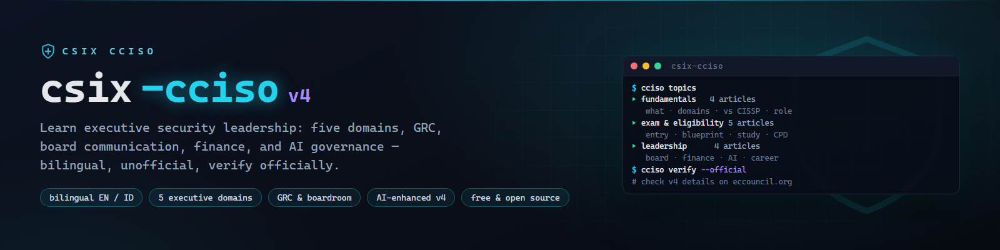

# csix-cciso



**Free bilingual (EN/ID) CCISO v4 learning base — executive security leadership, the five domains, eligibility, exam blueprint, governance frameworks, board communication, finance, AI governance, and CISO careers.**

[](https://github.com/siedysoes/csix-cciso/actions/workflows/ci.yml)
[](LICENSE)
[](https://siedysoes.github.io/csix-cciso/)
[](https://www.eccouncil.org/train-certify/certified-chief-information-security-officer-cciso/)

`csix-cciso` is a structured, beginner-friendly knowledge base about the
EC-Council **Certified Chief Information Security Officer (CCISO)** path.
The official program is currently branded **CCISO v4 — AI-Enhanced**
(checked 26 Nov 2026). It explains the five executive domains, eligibility
routes, the exam and blueprint, governance frameworks, board communication,
risk and finance, AI governance, and realistic leadership careers.

Each article is a **full study guide** (about 4,200–5,500 words) with learning
objectives, deep explanations, tables, ASCII decision diagrams, fictional
worked cases, scenario exercises with answer keys, reusable templates, a
glossary, and dated verification notes. This is deliberate: the material is
meant to be studied, not skimmed.

> ⚠️ **Independent study resource.** EC-Council, CCISO, CISSP, CISM, CISA and
> other credential names are trademarks of their respective owners. This
> project is **unofficial** and **not affiliated with or endorsed by
> EC-Council**. It contains no official courseware, exam dumps, or copyrighted
> content. Version, eligibility, exam format, pricing, renewal/CPD, and
> accreditation details change — **verify on
> [eccouncil.org](https://www.eccouncil.org/train-certify/certified-chief-information-security-officer-cciso/)**,
> [cert.eccouncil.org](https://cert.eccouncil.org/), and the
> [CCISO certification page](https://ciso.eccouncil.org/cciso-certification/).
>
> 📊 **On vendor statistics.** The official page publishes survey and Hall of
> Fame numbers (salary growth, job roles, recommendation rates, board risk
> statistics). Treat these as **vendor-published claims** with their own
> methodology — not as guarantees or independent market data. Verify against
> current job postings and primary sources before making decisions.
>
> ⚖️ **Education, not advice.** Nothing here is legal, financial, tax, or
> regulatory advice. Laws, regulations, and sector rules vary by country and
> change over time; consult qualified professionals and official sources.

> 🌐 **Read it on the web:** **https://siedysoes.github.io/csix-cciso/**

## What's inside

### Fundamentals (4 articles)

| Article | You'll learn |
|---------|--------------|
| [What Is CCISO v4](en/fundamentals/what-is-cciso.md) | The credential, current branding, and who it suits |
| [The Five Domains: Govern to Strategize](en/fundamentals/five-domains.md) | Govern, Lead, Operate, Secure, Strategize |
| [CCISO vs CISSP & Other Leader Creds](en/fundamentals/cciso-vs-cissp.md) | Focus differences; verify each issuer's current details |
| [The CISO Role: From Technical to Executive](en/fundamentals/ciso-role.md) | How the role shifts from systems to strategy and influence |

### Exam & Eligibility (5 articles)

| Article | You'll learn |
|---------|--------------|
| [Eligibility: Full CCISO & Associate Path](en/exam/eligibility.md) | Experience routes and the Associate path — verify officially |
| [CCISO Exam Format & Blueprint](en/exam/exam-format.md) | How to check the current blueprint and exam policies |
| [A Practical Study Plan](en/exam/study-plan.md) | A routine built on cases, writing, and leadership practice |
| [Frameworks & Tools for the Executive](en/exam/frameworks-tools.md) | ISO 27001, NIST CSF, COBIT, MITRE ATT&CK, Zero Trust, GRC |
| [Costs, Validity & CPD](en/exam/cost-validity.md) | Cost components, validity, and continuing education caveats |

### Leadership & Career (4 articles)

| Article | You'll learn |
|---------|--------------|
| [Board Communication & Executive Presence](en/career/board-communication.md) | Translating risk into business language |
| [Risk, Finance & Vendor Governance](en/career/risk-finance.md) | Budgets, ROI, CAPEX/OPEX, SLAs, third-party risk |
| [AI Governance: Reality Check](en/career/ai-governance.md) | AI risk, fairness, and the limits of vendor claims |
| [Careers After CCISO](en/career/cciso-careers.md) | CISO, VP Security, director, and advisory roles |

Every article exists in **English** (`en/`) and **Indonesian** (`id/`).

## Read on the web

The site is a static single-page app (no server, no tracking) served by
GitHub Pages — it renders the Markdown files from this repo live:

- 🌐 **https://siedysoes.github.io/csix-cciso/**
- Language toggle **EN ↔ ID** in the top bar
- Search box filters topics as you type
- In-article links navigate without page reloads

## Repository layout

```
csix-cciso/
├── index.html        # web app shell
├── app.js            # router + search + language toggle
├── style.css         # dark theme
├── topics.json       # topic manifest (titles + paths, EN/ID)
├── assets/           # banner
├── en/               # English articles
│   ├── fundamentals/
│   ├── exam/
│   └── career/
├── id/               # Indonesian articles
│   ├── fundamentals/
│   ├── exam/
│   └── career/
└── .github/workflows # CI: link + manifest validation
```

## Contribute

1. Fork and add/edit Markdown under `en/` (and translate under `id/`).
2. Register new topics in `topics.json` (both languages).
3. Open a pull request — CI checks that all links and manifest entries resolve.

Article style: pure Markdown, no front matter, `# Title` first line,
one `## See also` section with relative links at the end.
`WRITING-STANDARD.md` defines the full depth contract for every article.

## Related CSIX repos

- [CSIX ISO 27001:2022](https://siedysoes.github.io/csix-iso27001/) — ISMS requirements and Annex A controls
- [CSIX ISO 27001 Assessor](https://siedysoes.github.io/csix-iso27001-assessor/) — auditing and certification
- [CSIX COBIT 7](https://siedysoes.github.io/csix-cobit/) — IT governance
- [CSIX ITIL 5](https://siedysoes.github.io/csix-itil/) — service management
- [CSIX ECSA](https://siedysoes.github.io/csix-ecsa/) and [CSIX CPENT AI](https://siedysoes.github.io/csix-cpent/) — offensive-security paths

## Languages

- English (this file)
- [Bahasa Indonesia](README.id.md)

## License

MIT — see [LICENSE](LICENSE). Content is free to learn from, share, and adapt
with attribution. EC-Council, CCISO, CISSP, CISM, and CISA are trademarks of
their owners; this project is an independent, unofficial study resource.
